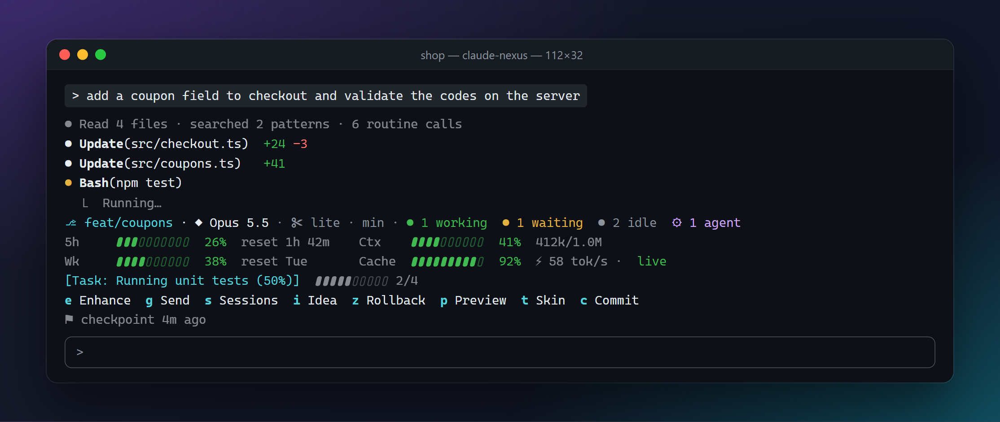
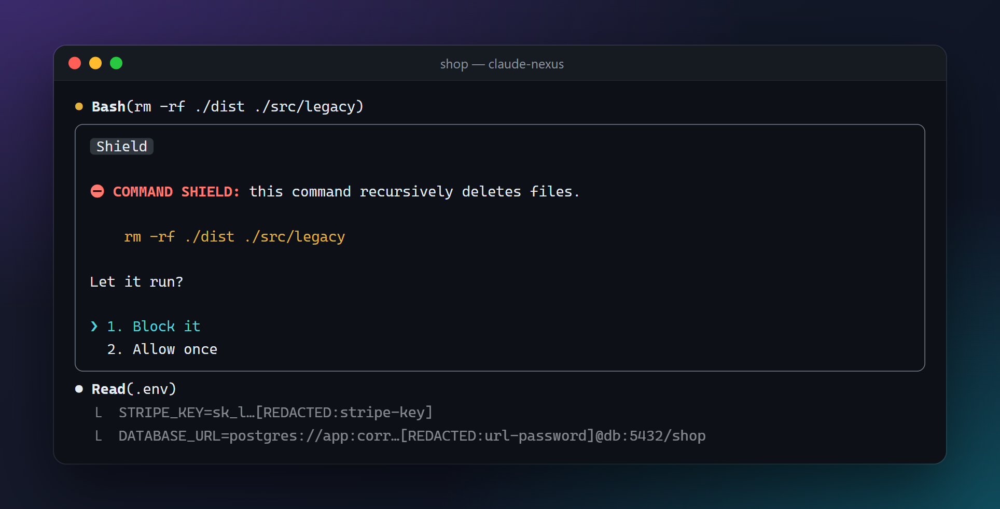
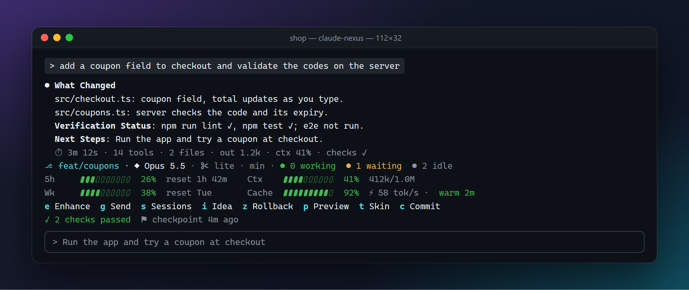
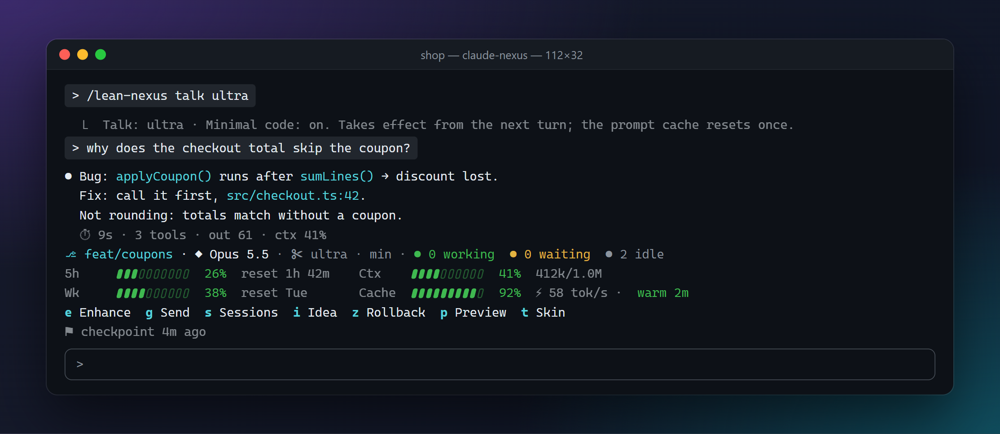
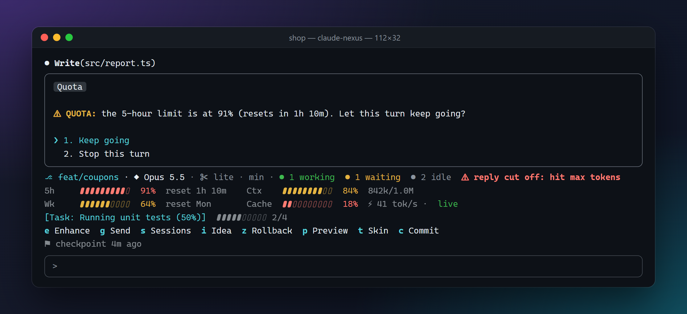
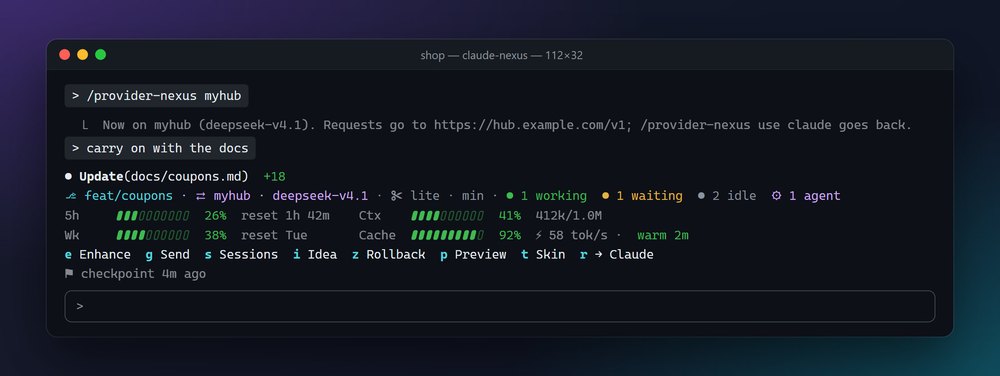
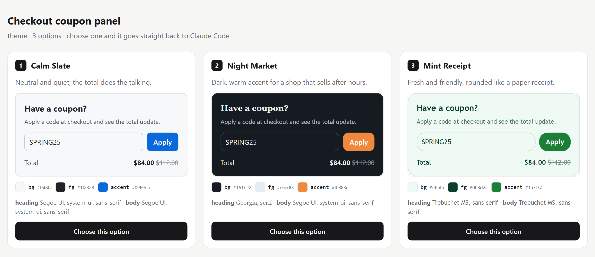
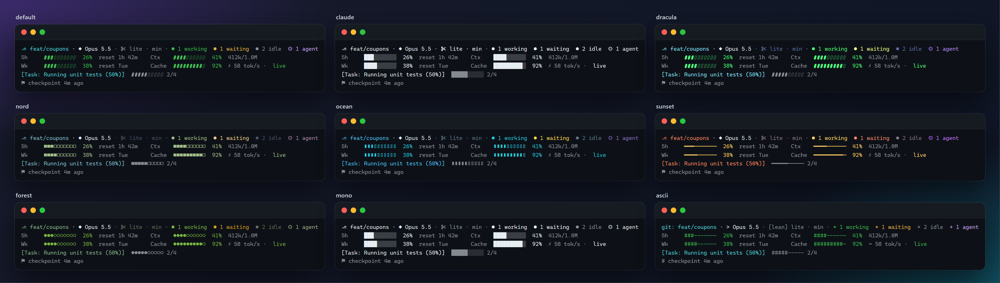

<h1 align="center">Nexus</h1>

<p align="center">
  <b>The all-in-one mod for Claude Code.</b><br>
  A live HUD above the prompt, guards that catch the dangerous moments, checks that run themselves,<br>
  replies that cost fewer tokens, and a router that keeps you working when Claude's quota runs out.
</p>

<p align="center">
  <a href="https://github.com/darkomarijaan/nexus-mod/releases/latest"></a>
  <a href="LICENSE"></a>
  
  
  
</p>

<p align="center">
  
</p>

Nexus is one plugin that turns Claude Code into a workspace you can see into. You always know which branch and model you are on, how much of your 5-hour and weekly limit is left and when it resets, how full the context is, whether the prompt cache is still warm, and what Claude is working on right now. Around that it adds the safety net (a command shield, secret masking, a checkpoint before every turn), the follow-through (lint and tests after every change, sent back to Claude when they fail) and the savings (lean replies, folded command output, a quota guard). Start Claude Code with `claude-nexus` and the same session can switch to your own model hub without a restart.

Everything runs locally inside Claude Code. No dependencies to install, no account, no telemetry.

> Screenshots are rendered from Nexus's own components with demo data, in a demo project called `shop`.

## Contents

- [What it looks like](#what-it-looks-like)
  - [The HUD](#the-hud) · [Guards](#guards) · [Checks and delivery](#checks-and-delivery) · [Lean mode](#lean-mode) · [Limits and quota](#limits-and-quota) · [Provider router](#provider-router) · [Design Lens](#design-lens) · [Skins](#skins) · [And the rest](#and-the-rest)
- [Install](#install)
- [Update](#update)
- [Commands and keys](#commands-and-keys)
- [Provider router setup](#provider-router-setup)
- [Settings](#settings)
- [Where it keeps things](#where-it-keeps-things)
- [Troubleshooting](#troubleshooting)
- [Development](#development)
- [Roadmap](#roadmap) · [License](#license)

## What it looks like

### The HUD

A band above the prompt that is always current. It is the screenshot at the top of this page.

| Row | What it shows |
|---|---|
| Header | Git branch, model, the [lean mode](#lean-mode) badge `✂ lite · min`, a light for every Claude Code session on the machine (green working, yellow waiting, gray idle) and running subagents (`⚙ 1 agent`) |
| `5h` / `Wk` | How much of the 5-hour and weekly limit is used, its reset, and a red `⚠ out ~1h 10m` when the pace runs the window out before it resets |
| `Ctx` / `Cache` | Context tokens against the window, prompt-cache hits, output speed (`⚡ 58 tok/s`) and how warm the cache is (`live`, `warm 2m`, `idle 12m`, `cold`) |
| Task | The task Claude is on and how much of its todo list is done |
| Action bar | One-key actions: Enhance, Send, Sessions, Idea, Rollback, Preview, Skin, Commit, and Claude ⇄ hub |
| Status | Check results and the latest checkpoint |

A red `⚠ reply cut off: hit max tokens` appears in the header when a reply stopped short. The quotas show on a Claude subscription once the first reply of the session arrives; on an API key there are none to show.

### Guards



- **Command Shield** asks before a dangerous shell command runs: recursive deletes (`rm -rf`, `Remove-Item -Recurse`, `find -delete`), force pushes, pushes to protected branches (`main,master,production,release`, `*` patterns allowed), `git reset --hard`, `git clean -f`, dropped tables, `curl | bash` and more. It sees through `sudo`, git global options, `xargs`, `busybox` and `timeout`.
- **Secret masking** hides API keys, tokens, passwords and private keys (Anthropic, OpenAI, AWS, GitHub, GitLab, Slack, Google, Stripe, npm, Hugging Face, JWTs, passwords in URLs) before anything is stored or sent to the model, and stops Claude from writing a mask back over the real secret.
- **Turn checkpoints**: before the first file change of each turn, Nexus snapshots the project into a private shadow git repo. `/rollback-nexus` (or `ctrl+x tab z`) puts the project back; `/rollback-nexus undo` brings the change back again. Your own `.git` is never touched.
- **Assumption review**: before a plan is shown, you confirm or correct the assumptions Claude made about your project.
- **Loop detector**: when the same call fails 3 times, or repeats 6 times, Claude is told to change approach; a turn past 20 minutes is flagged.

### Checks and delivery



- **Auto lint/test with self-heal**: after a turn that changed files, Nexus runs the project's own linters, type-check and tests. A failure goes back to Claude to fix (twice by default) before you are told.
- **Executive summary**: a quiet transcript while Claude works, then three headings at the end: **What Changed**, **Verification Status**, **Next Steps**.
- **Turn footer**: `⏱ 3m 12s · 14 tools · 2 files · out 1.2k · ctx 41% · checks ✓` under each answer.
- **Next-step suggestion**: the first Next Step waits in the prompt as a dim suggestion; Tab takes it.
- **Commit helper**: a **Commit** button (and `/commit-nexus`) drafts a message from the diff and commits once you confirm.
- **Done and approval alerts**: a desktop notification and a sound when a long turn finishes, a different sound when Claude needs your approval.

### Lean mode



Rules in Claude's system prompt, on by default, that cost fewer tokens and produce less code:

- **Lean talk**: `lite` answers first and drops greetings, recaps and filler; `ultra` goes telegraphic (one idea per line). Code, commands, paths, errors and numbers stay exact; warnings, irreversible steps and questions to you stay in full sentences. Negations (not, never, only; tidak, bukan, jangan, hanya) are never dropped, in any language.
- **Minimal code**: before writing code Claude climbs a ladder: does it need to exist, is it already in the codebase, the standard library, a native feature, an installed dependency, one line, and only then the minimum that works. Validation, security and accessibility are never cut.
- `/lean-nexus talk off|lite|ultra`, `/lean-nexus code on|off`, `off`, `on`, `reset`. The pick is remembered across sessions and takes effect from the next turn.
- `/lean-review-nexus [base]`: Claude reviews your uncommitted changes (or those since a branch) for over-engineering and reports `file:line`, the rung each breaks and a simpler alternative. It edits nothing.
- `/compress-nexus [file]`: shortens `CLAUDE.md` with the helper model, shows the saving, asks, and keeps the original. It refuses a result that changes a code block, inline code, a path, a URL or a number, that was cut off, or that saves under 5%.

### Limits and quota



- **Quota guard**: when the 5-hour or weekly limit passes 90% (configurable), Nexus asks whether the running turn goes on, or between turns whether your next prompt goes. Once per window.
- **Limit forecast**: from how fast usage climbs, a red `⚠ out ~1h 10m` when you will run out before the reset.
- **Compaction guard**: a warning at 80% context; compaction is told to keep file paths, open tasks, check results and decisions, and right after it Claude gets your last request word for word, the open tasks, the files touched and the opening of CLAUDE.md.
- **Context audit**: `/context-nexus` shows where the context goes before you type (system prompt, MCP servers, CLAUDE.md, skills by plugin, agent types) and what could go.
- **MCP servers per project**: `/mcp-nexus off <server>` keeps a server's tools out of Claude's way in this project; `on` brings it back.
- **Trimmed noisy output**: long install, build, test and log output reaches Claude with routine lines folded (problems, head and tail kept); the whole output is saved to a file Claude can read.

### Provider router



Start Claude Code with `claude-nexus` instead of `claude` and the session can switch between your Claude subscription and your own hub (any Anthropic Messages API, such as OmniRoute, LiteLLM or claude-code-router) without restarting. When Claude's plan limit is hit, Nexus holds the request and offers to finish the same turn on a hub, then offers Claude again once the quota resets. Your claude.ai login never reaches the hub, and the hub key never reaches Anthropic. `ctrl+x tab r` flips between Claude and the hub used last. Setup is [below](#provider-router-setup).

### Design Lens



When Claude would offer a choice between layouts, palettes, typography or component themes, it shows them as live cards in your browser (and a terminal pane) instead of describing them. Your pick goes straight back to Claude with its design tokens. `/preview-nexus [url]` screenshots your dev server; run it again after a change for a before and after.

### Skins



Nine looks for the HUD and drawers, each with its own colors, bar glyphs, icons and borders: `default`, `claude` (follows Claude Code's own `/theme`), `dracula`, `nord`, `ocean`, `sunset`, `forest`, `mono` and `ascii` (for fonts without Unicode). Switch with `/skin-nexus` or `ctrl+x tab t`; the pick is remembered across sessions, and Claude Code's own theme follows it.

### And the rest

- **Prompt enhancer**: `ctrl+x tab e` (or `/enhance-nexus <rough prompt>`) rewrites a rough prompt as Goal / Context / Acceptance criteria in the prompt box, for you to read before sending.
- **Sessions**: `/sessions-nexus` lists every Claude Code session on the machine with its subagents; inspect one, ask it to pause, message it or copy its resume command.
- **Session handoff**: each session's summary is saved, the next session in the project shows it, and `/handoff-nexus` hands it to Claude.
- **Idea pad**: `/idea-nexus <text>` saves an idea to `.claude/ideas.md` without interrupting Claude.
- **Subagent cap**: refuse new subagents past a number you set.

## Install

**Requirements**

- Claude Code 2.1.296 or newer
- `git` on PATH (checkpoints and rollback)
- `node` on PATH (optional: lets a click in the browser preview reach Claude)
- Microsoft Edge or Google Chrome (optional: `/preview-nexus` screenshots)

**From GitHub**

```
claude plugin marketplace add darkomarijaan/nexus-mod
claude plugin install nexus@nexus-mod
```

**From a local folder** (a clone, or the unzipped `nexus-mod.zip` from [Releases](https://github.com/darkomarijaan/nexus-mod/releases)), kept on an NTFS drive:

```
claude plugin marketplace add C:\path\to\nexus-mod
claude plugin install nexus@nexus-mod
```

Then run `/reload-plugins` in any open session, or start a new one. Type `/nexus` to see every module and its keys.

**Try it for one session only**

```
claude --plugin-dir C:\path\to\nexus-mod
```

## Update

```
claude plugin marketplace update nexus-mod
claude plugin update nexus@nexus-mod
```

From a local folder, first replace its contents with the new release (`git pull` in a clone, or unzip the new `nexus-mod.zip` over it), then `/reload-plugins` or start a new session. `claude plugin list` shows the installed version. What changed in each version is in the [changelog](CHANGELOG.md).

> Added the GitHub marketplace before 11 October 2026? The repository was recreated that day, so remove it once and add it again: `claude plugin marketplace remove nexus-mod`, then the two install commands above.

## Commands and keys

| Command | What it does |
|---|---|
| `/nexus` | Status of every module, and the keys |
| `/sessions-nexus` | Every Claude Code session on this machine: inspect, ask one to pause, message it, copy its resume command |
| `/idea-nexus <text>` | Save an idea to `.claude/ideas.md` without interrupting Claude (no text opens the scratchpad) |
| `/rollback-nexus` | Put the project back as it was before the latest turn (edits you made since are undone too). Also `list`, a number (`/rollback-nexus 3`) and `undo` |
| `/preview-nexus [url]` | Screenshot the dev server; run it again after changes for a before and after |
| `/handoff-nexus` | What the last session in this project did; Claude reads it too, so it can pick the work up |
| `/commit-nexus` | Commit every change in the work tree with a drafted message, after you confirm it |
| `/enhance-nexus <rough prompt>` | Rewrite a rough prompt as Goal / Context / Acceptance criteria into the prompt box |
| `/context-nexus` | Where the context goes before you type, and what could go |
| `/mcp-nexus` | MCP servers in this project; `off <server>`, `on <server>` |
| `/lean-nexus` | Terse replies and minimal code: `talk off\|lite\|ultra`, `code on\|off`, `off`, `on`, `reset` |
| `/lean-review-nexus [base]` | Review the changes for over-engineering; edits nothing |
| `/compress-nexus [file]` | Shorten `CLAUDE.md` (or another memory file) safely, with a backup |
| `/skin-nexus` | Skin picker; also `<name>`, `list`, `reset` |
| `/provider-nexus` | Provider profiles: add, edit, test, use; also `<name\|claude>`, `status`, `test <name>` |

**Keys**: press `ctrl+x`, let go, then `tab` to focus the bar above the prompt, then one letter.

| Key | Action |
|---|---|
| `e` | Enhance the prompt |
| `g` | Send |
| `s` | Sessions |
| `i` | Idea |
| `z` | Rollback |
| `p` | Preview |
| `t` | Skin (on a wide terminal) |
| `c` | Commit (after a turn that changed files, in a git repo) |
| `r` | Claude ⇄ hub (once a provider profile exists); in a plain `claude` session it copies the restart command |

Every key also has a command. A mod cannot take a bare `ctrl+z` or a `ctrl+x s` chord in this Claude Code build, so the keys go through the bar.

## Provider router setup

Switching providers needs Claude Code started through the launcher, `claude-nexus`, which puts a small local router in front of it. On the Claude route it behaves like plain `claude`, so you can use it every day; the one thing it gives up is Remote Control, which refuses any custom API address. Stay on plain `claude` when you want Remote Control.

1. **Once: put Nexus's `bin` folder on your PATH**, then open a new terminal.

   | Installed from | Nexus's `bin` folder |
   |---|---|
   | GitHub | `%USERPROFILE%\.claude\plugins\marketplaces\nexus-mod\bin` (Windows), `~/.claude/plugins/marketplaces/nexus-mod/bin` (macOS, Linux) |
   | A local folder | `<that folder>\bin`, for example `C:\path\to\nexus-mod\bin` |

   Windows (PowerShell), for a GitHub install:
   ```
   [Environment]::SetEnvironmentVariable('Path', [Environment]::GetEnvironmentVariable('Path', 'User') + ";$env:USERPROFILE\.claude\plugins\marketplaces\nexus-mod\bin", 'User')
   ```
   macOS, Linux: add `export PATH="$HOME/.claude/plugins/marketplaces/nexus-mod/bin:$PATH"` to `~/.zshrc` or `~/.bashrc`. Use these paths, not the copy under `.claude/plugins/cache/...`, whose name changes with every update. Check with `claude-nexus --version`; `claude-nexus` takes every `claude` argument (`claude-nexus --resume <id>`, `claude-nexus -c`).
2. **Once: add a profile.** `/provider-nexus` → **Add profile**: a name, the hub URL (the base that ends in `/v1`, such as `https://hub.example.com/v1`), the API key, the models for opus, sonnet and haiku picked from the hub's list, the context window, and whether to offer it when Claude's quota runs out. **Test** sends one short request per model. Profiles, keys included, live in Nexus's local store and are masked everywhere.
3. **Switch** with `ctrl+x tab r`, **Use** in the pane, or `/provider-nexus myhub`. It takes effect at the next request; `r` again (or `/provider-nexus claude`) goes back. The HUD shows `⇄ <profile> · <model>` while a hub is in use.
4. **From a plain `claude` session** the same switch copies `cd "<project>"; claude-nexus --resume <this session>`: type `/exit`, paste, Enter, and the conversation goes on under `claude-nexus`, already on that profile.

The hub must speak the Anthropic Messages API (`POST <hub URL>/messages`). Set `NEXUS_ROUTER_DEBUG=1` before `claude-nexus` to log each request's route and status to `~/.claude/nexus/router-<pid>.log`.

## Settings

Change these with `/plugin configure nexus@nexus-mod` (or `/plugin`, pick nexus, then Configure).

| Setting | Default | What it controls |
|---|---|---|
| Command Shield | on | Ask before dangerous commands |
| Protected branches | `main,master,production,release` | Branches guarded against pushes; `*` matches any part (`release/*`) |
| Secret Leak Sanitizer | on | Mask credentials |
| Turn checkpoints | on | Snapshot before each turn's first change |
| Assumption review | `plan` | `plan`, `first-edit` or `off` |
| Auto lint/test | on | Run project checks after changes |
| Self-heal attempts | `2` | Times a failure is sent back to Claude |
| Check timeout | `180` s | Longest one check may run |
| Quiet transcript | on | Routine tool calls drawn as one line |
| Executive summary | on | What Changed / Verification Status / Next Steps |
| Lean talk | `lite` | Terse replies: `off`, `lite` or `ultra` |
| Minimal code | on | Climb the minimal-code ladder before writing code |
| Design Lens | on | Visual design cards |
| Dev server URL | empty | `/preview-nexus` target (empty: probe localhost) |
| Helper model | `haiku` | Model for Enhance, assumption review, commit messages and `/compress-nexus` |
| Done / approval alerts | on | Notification and sound when a long turn ends or Claude needs you |
| Alert after | `30` s | Only turns at least this long raise the done alert |
| Compaction guard | on | 80% warning, what compaction must keep, and the note to Claude after it |
| Session handoff | on | Save each session's summary for the next |
| Loop detector | on | Break repeated failing calls; flag 20-minute turns |
| Max subagents at once | `0` | Refuse new subagents past this many (0: no limit) |
| Next-step suggestion | on | Offer the reply's first Next Step as the prompt suggestion |
| Commit helper | on | Commit button and `/commit-nexus` |
| Theme | `default` | Starting skin; a `/skin-nexus` pick overrides it until `/skin-nexus reset` |
| Claude Code theme follows the skin | on | A dark skin moves Claude Code's own theme to dark (daltonized kept), `ascii` to ANSI; `default` and `claude` put yours back |
| Trim noisy output | on | Fold routine lines of long install, build, test and log output |
| Quota guard | `90` % | Ask before going on past this share of the 5-hour or weekly limit (0: off) |
| Turn footer | on | Time, tools, files, output tokens, context and checks under each answer |
| Provider fallback | `ask` | In a `claude-nexus` session, when Claude's plan limit is hit: `ask`, `auto` (the default fallback profile) or `off` |

## Where it keeps things

Nothing leaves your machine except what Claude Code itself sends.

- Checkpoints live in a private shadow git repo under `~/.claude/nexus/shadow/`; your project's own `.git` is never touched. The last 40 are kept; older ones are freed at most once a week. Rollback does not cover `node_modules`, `dist`, `build`, `.venv` or other build folders.
- Previews and screenshots: `~/.claude/nexus/previews/`.
- Whole outputs of trimmed commands: `~/.claude/nexus/outputs/` (the last 30).
- `/compress-nexus` backups: `~/.claude/nexus/backups/<project folder>-<file>.bak-<time>`, never in your project; a refused result is left in `~/.claude/nexus/outputs/compress-last.md` for comparison.
- Session handoffs, provider profiles and your skin and lean picks: the plugin's own store. On its own, Nexus writes nothing into your project; it changes files only when you ask (rollback, commit, compress) and saves `.claude/ideas.md` when you jot an idea.
- Sounds use the system's own (`Windows Notify System Generic` and `Windows Exclamation` on Windows). Whether a notification shows as a desktop toast depends on Claude Code's notification channel (`/config`, Notifications).

## Troubleshooting

**The install fails with `EISDIR ... readlink`.** Claude Code cannot read a plugin folder on an exFAT or FAT32 drive. Keep the folder on an NTFS drive.

**`ctrl+x tab` does nothing in VS Code.** Turn on `terminal.integrated.sendKeybindingsToShell`, or use the commands (`/enhance-nexus`, `/rollback-nexus`, …). Press `ctrl+x`, let go, then `tab`: `ctrl+x` alone shows nothing.

**The HUD shows no 5-hour or weekly limit.** They appear on a Claude subscription after the first reply of the session; an API key has none.

**Remote Control is unavailable.** It refuses any custom API address, so it only works in plain `claude`, not in `claude-nexus`.

**A script or nested `claude` inside a `claude-nexus` session gets a 401.** It inherits `ANTHROPIC_BASE_URL` and reaches the router without its token. Unset `ANTHROPIC_BASE_URL` for it.

**`claude-nexus` warns about a settings file at start.** `env` in `~/.claude/settings.json`, `.claude/settings.json` or `.claude/settings.local.json` overrides what the launcher sets. Remove `ANTHROPIC_BASE_URL`, `ANTHROPIC_CUSTOM_HEADERS` or `ANTHROPIC_AUTH_TOKEN` from the file it names.

**Something seems off.** `/nexus` shows which modules are on; turn any of them off in `/plugin configure nexus@nexus-mod`.

## Development

```
claude plugin test .            # hook tests (tests/*.test.ts)
node --test bridge/*.test.mjs   # router and launcher tests
claude plugin validate .        # manifest and types contract
claude --plugin-dir .           # try the working tree in a session
```

The hooks live in `hooks/` (TypeScript; `register.tsx` is the only module that talks to Claude Code, every other module is pure logic with its own tests) and the router and launcher in `bridge/` (plain Node, no dependencies). [CLAUDE.md](CLAUDE.md) has the architecture and the mod API gotchas found along the way.

## Roadmap

- **v0.5**: provider router; v0.5.1: one-key switch, switching from a plain session by resuming it under `claude-nexus`.
- **v0.6** (this version): lean mode (terse replies, minimal code), `/lean-review-nexus`, `/compress-nexus`.
- **v0.7**: test-tamper guard, evidence check before "done", `/review-nexus`.
- **v0.8**: hunk-level diff review, plan annotation in the browser.
- Later: Telegram remote control, session search, worktree cockpit.

## License

MIT, see [LICENSE](LICENSE).
